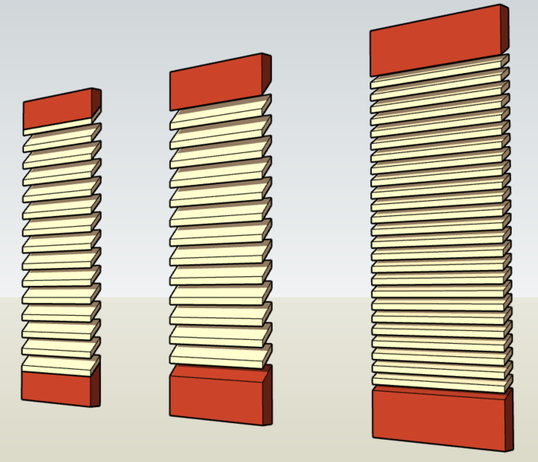

  

Plugin écrit en Ruby pour SketchUp qui génère automatiquement une persienne à la française, incluant les traverses hautes et basses.

Un petit utilitaire pour SketchUp permettant de générer rapidement des lames de persiennes à partir de paramètres simples.

## 📝 Description

Ce plugin automatise la création de séries de lames de persiennes. Plutôt que de dessiner et dupliquer manuellement chaque élément, l'utilisateur définit les dimensions, l'angle et la hauteur totale. Le plugin calcule alors dynamiquement le nombre de lames optimal et gère leur placement ainsi que celui des traverses structurelles.

## 🚀 Fonctionnalités

- **Génération Paramétrique** : Contrôle sur la largeur, l'épaisseur, l'angle et le recouvrement des lames.
- **Calcul Dynamique** : Calcul automatique du nombre de lames et de l'espacement vertical basé sur la hauteur totale.
- **Options Structurelles** : Gestion des traverses (hautes et basses) avec option d'intégration des lames aux extrémités.
- **Validation Intégrée** : Système de vérification des saisies pour empêcher les valeurs aberrantes ou négatives avant la génération.
- **Conversion d'Unités** : Gestion transparente des conversions entre centimètres (Saisie UI) et pouces (API SketchUp).
- **Journalisation (Logging)** : Système de logs détaillé (`LouverLogger`) pour suivre le processus de génération et faciliter le débogage.
- **Persistance de Session** : Mémorisation des derniers paramètres utilisés pour un flux de travail accéléré.

## 🏗 Architecture Technique

Le plugin suit une architecture modulaire rigoureuse pour séparer la logique métier de l'interface utilisateur :

- **Root Loader** : Point d'entrée unique assurant le chargement ordonné des modules.
- **Namespacing Total** : Encapsulation complète dans le namespace `LouverBlade` pour éviter tout conflit avec d'autres extensions.
- **Modularité** :
    - `Constants` : Gestion centralisée des versions et configurations par défaut.
    - `Logic (Louver)` : Moteur de calcul mathématique et trigonométrique indépendant de la géométrie.
    - `Builder (GeometryBuilder)` : Responsable de la création des entités 3D et des composants SketchUp.
    - `UIHandler` : Gestion des dialogues, validation des données et stockage session.
    - `LouverLogger` : Gestionnaire de logs centralisé (Console, Status Bar et Messagebox).

## 📦 Installation

### Pour les utilisateurs (Fichier .rbz)
1. Téléchargez le fichier `.rbz` dans le dossier `release`.
2. Dans SketchUp, allez dans **Window** $\rightarrow$ **Extension Manager**.
3. Cliquez sur **Install Extension** et sélectionnez le fichier téléchargé.

## 📋 Prérequis
- **SketchUp 2020** ou version ultérieure.
- **Ruby** (intégré à SketchUp).

## 📄 Licence
Ce projet est distribué sous la licence MIT. Voir le fichier `LICENSE` pour plus de détails.