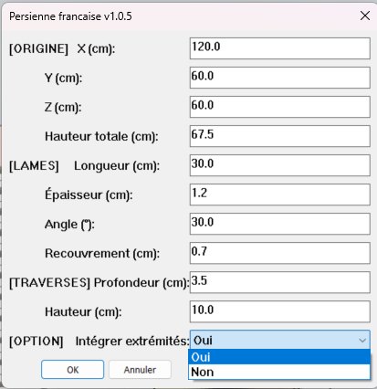
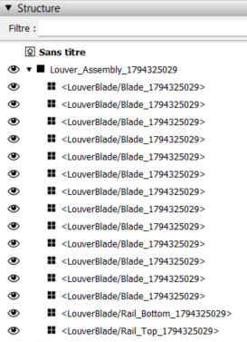

## Aperçu du résultat
Voici un exemple de volume généré avec les paramètres par défaut):

  

# 🪵 Générateur de Persienne à la française pour SketchUp 

Plugin écrit en Ruby pour SketchUp qui génère automatiquement une persienne à la française, incluant les traverses hautes et basses.

Ce plugin automatise la création de séries de lames de persiennes. Plutôt que de dessiner et dupliquer manuellement chaque élément, l'utilisateur définit les dimensions, l'angle et la hauteur totale. Le plugin calcule alors dynamiquement le nombre de lames optimal et gère leur placement ainsi que celui des traverses structurelles.

## 📦 Installation

### Méthode Automatique  (Fichier .rbz)
1. Aller dans la section **Releases** de ce dépôt.
2. Télécharger le fichier `.rbz` le plus récent.
3. Dans SketchUp : `Fenêtre` $\rightarrow$ `Gestionnaire d'extensions` $\rightarrow$ `Installer l'extension`.
4. Sélectionner le fichier `.rbz`.

## 🚀 Fonctionnalités

  

- **Génération Paramétrique** : Contrôle sur la largeur, l'épaisseur, l'angle et le recouvrement des lames.
- **Calcul Dynamique** : Calcul automatique du nombre de lames et de l'espacement vertical basé sur la hauteur totale.
- **Options Structurelles** : Gestion des traverses (hautes et basses) avec option d'intégration des lames aux extrémités.
- **Validation Intégrée** : Système de vérification des saisies pour empêcher les valeurs aberrantes ou négatives avant la génération.
- **Conversion d'Unités** : Gestion transparente des conversions entre centimètres (Saisie UI) et pouces (API SketchUp).
- **Journalisation (Logging)** : Système de logs détaillé (`LouverLogger`) pour suivre le processus de génération et faciliter le débogage.
- **Persistance de Session** : Mémorisation des derniers paramètres utilisés pour un flux de travail accéléré.

  

## 📋 Prérequis
- **SketchUp 2020** ou version ultérieure.
- **Ruby** (intégré à SketchUp).

## 📄 Licence
Ce projet est distribué sous la licence MIT. Voir le fichier `LICENSE` pour plus de détails.