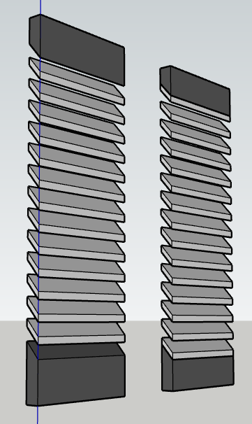

<p align="center">
  
</p>

# Louver Blade Generator

Un petit utilitaire pour SketchUp permettant de générer rapidement des lames de persiennes à partir de paramètres simples.

## 📝 Description

Ce plugin permet de créer des séries de lames de persiennes sans avoir à les dessiner manuellement. L'utilisateur définit les dimensions et l'angle, et le plugin s'occupe de la répétition et du placement.

## 🚀 Fonctionnalités

- **Génération Paramétrique** : Contrôle total sur la largeur, l'épaisseur, l'espacement et l'angle des lames.
- **Conversion d'Unités Intégrée** : Gestion transparente des conversions entre centimètres et pouces.
- **Persistance de Session** : Mémorisation des derniers paramètres utilisés durant la session de travail pour un flux de création accéléré.
- **Optimisation Géométrique** : Création de groupes propres pour faciliter l'édition manuelle après génération.

## 🏗 Architecture Technique

Le plugin suit une architecture qui permet de séparer la logique métier de l'interface utilisateur :

- **Root Loader** : Un fichier d'entrée unique assurant le chargement sécurisé des modules.
- **Namespacing Total** : Tout le code est encapsulé dans le namespace `LouverBlade` pour éviter tout conflit avec d'autres extensions SketchUp.
- **Modularité** :
    - `Constants` : Gestion centralisée des versions et valeurs par défaut.
    - `Logic` : Moteur de calcul mathématique indépendant de l'API SketchUp.
    - `Builder` : Interface de création d'entités 3D.
    - `UIHandler` : Gestion des dialogues et stockage session via variables de classe (`@@`).
    - `Main` : Orchestrateur du flux de données.

## 📦 Installation

### Pour les utilisateurs (Fichier .rbz)
1. Téléchargez le fichier `.rbz` dans le dossier `release`.
2. Dans SketchUp, allez dans **Window** $\rightarrow$ **Extension Manager**.
3. Cliquez sur **Install Extension** et sélectionnez le fichier téléchargé.

### Pour les développeurs (Source)
1. Clonez le dépôt : `git clone https://github.com/votre-username/louver-blade-generator.git`
2. Copiez le dossier `src/louver_blade_generator` dans le dossier `Plugins` de SketchUp :
   - **Windows**: `%AppData%\SketchUp\SketchUp 2020\SketchUp\Plugins`
   - **macOS**: `~/Library/Application Support/SketchUp 2020/SketchUp/Plugins`

## 🛠 Développement et Build

Le projet utilise un script de build automatisé pour Git Bash qui extrait dynamiquement le numéro de  version depuis le code source.

**Pour générer le package d'installation :**
```bash
sh build_plugin.sh
```
Le fichier résultat sera déposé dans le dossier `/release` sous le format `louver_blade_generator_v{VERSION}.rbz`.

## 📋 Prérequis
- **SketchUp 2020** ou version ultérieure.
- **Ruby** (intégré à SketchUp).

## 📄 Licence
Ce projet est distribué sous la licence MIT. Voir le fichier `LICENSE` pour plus de détails.